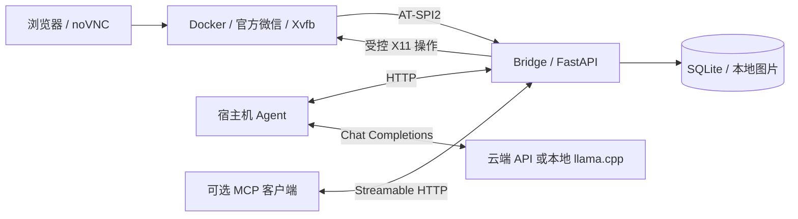

# Agent-Accessible-Wechat

在独立的 Docker 桌面中运行官方 Linux 微信，通过 AT-SPI2 读取一个指定群聊。Bridge 负责消息同步、SQLite 和受控发送。宿主机 Agent 负责人格、记忆与模型调用，可以接入兼容 Chat Completions 的云端服务或本地 llama.cpp。默认以人工确认方式发送。

当前内置无障碍配置适用于微信 `4.1.13.29` 的 ARM64 英文界面。AMD64、其他语言和其他版本按实际无障碍树配置。登录后的采集、发送和原生操作验收范围见[验证记录](#验证记录)。



## 安装

### Apple Silicon / macOS

使用 Docker Desktop，或使用 Homebrew 安装 Colima、Docker CLI、Buildx 和 Compose。Agent 另需 uv。首次在 8GB Mac 上启动 Colima 可从 2 核、3GB 内存、20GB 磁盘起步。

```bash
brew install colima docker docker-compose docker-buildx uv
colima start --cpus 2 --memory 3 --disk 20
docker info --format '{{.Architecture}}'
docker compose version
docker buildx version
```

如果已安装 Homebrew 插件但 Docker CLI 找不到它们，在缺少相应链接时运行。

```bash
mkdir -p ~/.docker/cli-plugins
ln -s "$(brew --prefix)/lib/docker/cli-plugins/docker-compose" ~/.docker/cli-plugins/docker-compose
ln -s "$(brew --prefix)/lib/docker/cli-plugins/docker-buildx" ~/.docker/cli-plugins/docker-buildx
```

### Ubuntu 24.04 / x86_64

按官方步骤配置 Docker 软件源并安装 `docker-ce`、`docker-ce-cli`、`containerd.io`、`docker-buildx-plugin` 和 `docker-compose-plugin`。用可以访问本机 Docker Engine 的账户操作。 [Docker Engine 安装](https://docs.docker.com/engine/install/ubuntu/) · [uv 安装](https://docs.astral.sh/uv/getting-started/installation/)

```bash
sudo apt-get update
sudo apt-get install -y git curl openssl ca-certificates
curl -LsSf https://astral.sh/uv/install.sh | sh
docker info --format '{{.Architecture}}'
docker compose version
docker buildx version
```

安装 uv 后，如果当前 Shell 尚未识别命令，按安装提示更新 `PATH` 或重新打开终端。

Bridge 镜像根据 BuildKit 的 `TARGETARCH` 下载对应的官方微信安装包。Ubuntu x86_64 使用 `linux/amd64`，Apple Silicon 的原生 Docker 引擎使用 `linux/arm64`。微信桌面使用软件渲染，GPU 可留给宿主机上的模型服务。 [腾讯 Linux 微信](https://linux.weixin.qq.com/)

## 从新克隆启动

```bash
git clone https://github.com/MyouKin/Agent-Accessible-Wechat.git
cd Agent-Accessible-Wechat

if [ ! -e .env ]; then
  (
    umask 077
    printf 'BRIDGE_TOKEN=%s\nVNC_PASSWORD=%s\nBRIDGE_CONFIG_FILE=./config.local.yaml\n' \
      "$(openssl rand -hex 24)" "$(openssl rand -hex 4)" > .env
  )
fi
if [ ! -e config.local.yaml ]; then
  (umask 077; cp config.yaml config.local.yaml)
fi
```

已有 `.env` 时，检查 `BRIDGE_CONFIG_FILE=./config.local.yaml` 指向自己的配置。Docker 容器以 UID 1000 运行。在 Linux 宿主账户使用其他 UID 时，启动前为容器 UID 1000 授予本地配置文件的读取权限。可使用 `setfacl -m u:1000:r config.local.yaml`。缺少该命令时可用 `sudo apt-get install acl` 安装。

```bash
docker compose up -d --build --wait
docker compose ps
curl --fail --silent http://127.0.0.1:8765/health
```

打开 [本机 noVNC](http://127.0.0.1:6080/vnc.html?autoconnect=1&resize=scale)，输入 `.env` 中的 `VNC_PASSWORD`。用手机微信扫码并确认登录。打开一个参与者同意用于联调、标题唯一的群聊，将消息列表滚动到最新处。测试时保持微信窗口和目标群可见。

`/health` 返回成功表示 HTTP 服务已启动。采集和自动操作需用 Bridge 凭据检查 `/status`。`source.ready` 和 `source.at_tail` 需为 `true`，以确认目标与可见尾部。首次可用快照建立基线，后续新消息才进入增量记录。

```bash
set -a
. ./.env
set +a
bridge_url="http://127.0.0.1:8765"
curl --fail --silent -H "Authorization: Bearer $BRIDGE_TOKEN" "$bridge_url/status"
```

API 和 noVNC 默认发布到宿主机环回。`BRIDGE_PORT` 和 `NOVNC_PORT` 可在 `.env` 中改变宿主机端口。VNC 密码要求 8 位 ASCII 字母或数字。Bridge API 使用独立 Bearer 令牌。

在远程 Ubuntu 主机上跑 Bridge 时，可从本地通过 SSH 映射 noVNC 端口。

```bash
ssh -N -L 16080:127.0.0.1:6080 user@server
```

连接后打开 [本地转发的 noVNC](http://127.0.0.1:16080/vnc.html?autoconnect=1&resize=scale)。

## 诊断 AT-SPI2 与选择器

在登录后的虚拟桌面中打开目标群，再从同一个容器和同一个 D-Bus 会话运行诊断。

```bash
docker compose exec bridge sh -c \
  '. "$XDG_RUNTIME_DIR/bridge-session.env"; python -m tools.inspect_atspi --events 10'
docker compose exec bridge sh -c \
  '. "$XDG_RUNTIME_DIR/bridge-session.env"; python -m tools.inspect_atspi --redact --events 8 --json /data/atspi-redacted.json'
mkdir -p diagnostics
docker compose cp bridge:/data/atspi-redacted.json diagnostics/atspi-redacted.json
docker compose exec bridge dpkg-query -W wechat
```

JSON 树包含角色、名称、描述、接口、边界、状态以及客户端提供的 Text、Image、Hypertext 和 Hyperlink 信息。`--all` 列出所有应用树，`--app` 可指定应用名。诊断文件可能包含聊天和成员资料，分享前使用 `--redact` 并检查内容。导出命令要求目标文件尚不存在。

在 `config.local.yaml` 填写群聊完整标题。仅在安装包、架构和桌面语言匹配时使用 `accessibility_profile: wechat-4.1.13.29-arm64-en`。其他环境可先保持 `accessibility_profile: null`，完成诊断后填写自定义映射。

| 配置 | 说明 |
| --- | --- |
| `chat` | 完整且唯一的群聊标题。留空可登录和诊断。 |
| `source` | 第一阶段使用 `accessibility`。 |
| `poll_interval` | Bridge 轮询间隔，默认 0.5 秒。AT-SPI 事件也会触发刷新。 |
| `accessibility_profile` | 内置配置名称、自定义映射或 `null`。 |
| `lookup_sender_names` | ARM64 已验证配置可在输入框为空时读取新消息的联系人卡片。默认关闭。 |
| `native_image_viewer` | ARM64 已验证配置可尝试用微信照片查看器补充图片。默认关闭。 |
| `send_mode` / `send_key` | 默认 `manual` / `Return`。发送键也可为 `ctrl+Return`。 |
| `mcp_enabled` | 默认关闭。启用时需要独立的 `MCP_TOKEN`。 |
| `data_dir` | 容器内 Bridge SQLite 与媒体文件的目录，默认 `/data`。 |

自定义映射至少填写 `package_version`、`window`、`chat_header`、`message_list`、`message_row` 和 `input`。选择器可使用由实际树得到的相对 `path`，或组合 `role`、`name`、`description`、`accessible_id`、`interfaces` 和 `attributes`。根据诊断补充 `body`、`sender`、`self_marker`、`other`、`image`、`sticker`、`link`、`timestamp` 与 `non_message`。尾部判断使用验证过的 `tail`、`scrollbar` 或实际列表尾行。支持 Value 接口的滚动条可设置 `recovery_step` 和 `recovery_pages`。

修改后重新创建 Bridge，而后复查 `/status`。在已登录且目标群可见时，可运行只读配置检查。它不会输入或发送消息，也不会输出聊天正文。

```bash
docker compose up -d --force-recreate bridge
curl --fail --silent -H "Authorization: Bearer $BRIDGE_TOKEN" "$bridge_url/status"
docker compose exec bridge sh -c \
  '. "$XDG_RUNTIME_DIR/bridge-session.env"; python -m tools.inspect_atspi --check-profile /app/config.yaml --json -'
```

检查返回码为 `0` 时，已验证可读目标群和可见尾部。`2` 表示尚未就绪，`1` 表示配置或会话错误。另看 `manual_send_preconditions`，它核对当前 X11 窗口、可读空输入框和引用预览是否为空。自定义配置要发送普通文本，须设置 `quote_preview`，让选择器能找到真实且隐藏的原生引用预览面板。可在微信中手动放入一条待发送引用再清除，对照两种树来定位该控件。缺少或无法核实该证据时，发送保持停用。原生引用、联系人卡片和照片查看器操作依赖已验证的内置配置。

在测试群依次发送短文本、同文两条和图片，通过 `/messages/new` 检查记录顺序、归属和媒体，再核对客户端发送键。

## 草稿、人工确认和自动发送

先保留 `send_mode: manual`。在目标群尾部、发送输入框为空并且 `source.ready` 为真时创建测试草稿。

```bash
request_id="$(openssl rand -hex 16)"
curl --fail --silent -X POST "$bridge_url/drafts" \
  -H "Authorization: Bearer $BRIDGE_TOKEN" \
  -H 'Content-Type: application/json' \
  --data "{\"text\":\"这是一条待确认的测试消息\",\"request_id\":\"$request_id\"}"
```

草稿初始为 `pending`。通过 `GET /drafts/{id}` 检查文本和引用，确认它应发到当前测试群后，再将下例中的 `DRAFT_ID` 换成实际返回的数字 ID。

```bash
curl --fail --silent -X POST "$bridge_url/drafts/DRAFT_ID/confirm" \
  -H "Authorization: Bearer $BRIDGE_TOKEN"
```

Bridge 会重新核对微信窗口、目标群、可见尾部和空输入框。发送后回读输入框及新消息，结果为 `sent`、`failed` 或 `uncertain`。遇到 `uncertain` 时先核对桌面、群聊尾部和草稿状态。相同 `request_id` 的重复请求沿用原草稿。

自动发送需要在 `config.local.yaml` 设置 `send_mode: auto`，重新创建 Bridge，并在 Agent 的 `.env.agent` 设置 `AGENT_AUTO_SEND=true`。直接调用 HTTP 自动发送还须在每个请求中明确传入 `auto_send: true` 和稳定的 `request_id`。可先验证一次普通文本与原生引用的人工流程，再开启自动模式。Agent 在 Bridge 未就绪、目标改变或发送模式不匹配时暂停处理。

## HTTP 与 MCP

除 `GET /health` 外，HTTP API 使用 `Authorization: Bearer $BRIDGE_TOKEN`。下面示例沿用启动章节的 `bridge_url`。

```bash
curl --fail --silent -H "Authorization: Bearer $BRIDGE_TOKEN" \
  "$bridge_url/messages/new?after_id=0&limit=50"
curl --fail --silent --get -H "Authorization: Bearer $BRIDGE_TOKEN" \
  --data-urlencode 'q=测试' "$bridge_url/messages/search"
```

| HTTP 端点 | 用途 |
| --- | --- |
| `GET /health` / `GET /status` | 进程探测，以及窗口、源版本、尾部和同步状态。 |
| `GET /messages` / `GET /messages/new?after_id=ID` | 近期记录和按 ID 分页的增量。 |
| `GET /messages/search?q=…` | 在本群本地记录中搜索。近期和搜索端点可用 `for_model=true` 获取过滤视图。Agent 自身读取带归属信息的完整视图。 |
| `GET /media/{message_id}?index=0` | 读取已采集图片。已保存第二张时用 `index=1`。 |
| `POST /drafts` / `GET /drafts` / `GET /drafts/{id}` | 创建或检查草稿。除 `text` 外，可传 `chat`、`request_id`、`author_kind`、`quote_message_id`。 |
| `POST /drafts/{id}/confirm` | 人工确认并执行受控发送。 |
| `GET /memories` / `POST /memories` | 读取或保存当前群的长期记忆。 |

原生引用通过本地 `quote_message_id` 选择目标。Bridge 会核实可见文本行和当前群，调用微信自己的引用菜单，再回读引用预览。目标不可见、重复候选或预览不符时，发送不会继续。模型只能选择进入其上下文且符合条件的真人文本作为原生引用目标。

MCP 是可选的 Streamable HTTP 接口。将 `mcp_enabled` 设为 `true`，用 `openssl rand -hex 24` 生成与 `BRIDGE_TOKEN` 不同的 `MCP_TOKEN` 并保存到 `.env`，重新创建 Bridge。客户端连接 `http://127.0.0.1:8765/mcp`，使用 `Authorization: Bearer <MCP_TOKEN>`。

可用工具为 `get_status`、`get_recent_messages`、`get_new_messages`、`search_messages`、`get_media`、`draft_message`。`draft_message` 支持创建引用草稿。确认发送由带有 Bridge 控制令牌的 HTTP 接口或明确配置的 Agent 完成。 [MCP Python SDK](https://github.com/modelcontextprotocol/python-sdk)

## 配置和启动宿主机 Agent

```bash
uv sync --locked --python 3.12
if [ ! -e .env.agent ]; then
  (umask 077; cp .env.agent.example .env.agent)
fi
```

在 `.env.agent` 填写 `LLM_BASE_URL`、`LLM_MODEL` 和提供方需要的 `LLM_API_KEY`，然后设置 `AGENT_MENTIONS` 为账号在目标群中的真实显示昵称。多个别名以逗号分隔。项目提供的 `persona.md` 是可编辑的原始人格示例。私有人格可另存为 UTF-8 Markdown，并将 `AGENT_PERSONA_PATH` 指向该文件，重启 Agent 后生效。建议使用本机私有文件或安全输入保存模型密钥，Compose 容器只读取其声明的 Bridge 凭据。 [uv 环境文件](https://docs.astral.sh/uv/configuration/files/#environment-variable-files)

用合成对话验证模型配置。`--demo` 访问配置的模型服务，需要模型可用并可能产生 API 用量。

```bash
uv run --locked --env-file .env --env-file .env.agent python -m agent --demo
```

Bridge 就绪后，启动真实群聊 Agent。如果模型端点位于非环回地址，先取得参与者对共享群聊数据的同意，再设置 `AGENT_DATA_CONSENT=true`。云端模型可能接收所选消息、引用、长期摘要及启用的图片内容。`LLM_MODEL`、可选 `LLM_MAX_TOKENS` 和 `LLM_REASONING_EFFORT` 以提供方协议为准。 [DeepSeek Chat Completions](https://api-docs.deepseek.com/api/create-chat-completion/)

```bash
uv run --locked --env-file .env --env-file .env.agent python -m agent
```

- `AGENT_AUTO_SEND` 默认关闭，可先检查 `/drafts` 中的建议。`AGENT_ALLOW_UNATTRIBUTED_MENTIONS=true` 可在人工模式处理归属未知的精确点名，这类触发只生成草稿。
- `AGENT_POLL_SECONDS` 默认 10 秒。确认来自真人的正文点名，以及对已验证 Agent 消息的引用，会逐条进入优先队列。普通参与依赖新的人类消息，两次普通判断至少间隔 60 秒。
- 模型首先使用结构化回复，支持工具的提供方可启用 `LLM_QUOTE_TOOL=true`。紧急触发可进行一次纯文本重试。模型仍无可用结果时，Agent 可对已验证的紧急触发生成简短确认，仍受同样的发送校验与幂等约束。
- `AGENT_SELECTIVE_PARTICIPATION=false` 关闭普通选择性参与。引用中的旧正文作为上下文，只有新正文的点名才触发直接点名。人类群友、同账号真人和 Agent 自己生成的消息以不同归属提供给模型。
- `AGENT_MULTIMODAL=true` 允许视觉模型从 Bridge 接收当前上下文已保存的图片。群聊中的链接作为文本处理。
- `AGENT_STATE_PATH` 默认 `data/agent.db`。它保存游标、去重和待处理决策。新的 Agent 状态会从当前 Bridge 的最新本地记录开始。自定义宿主端口时同时设置 `AGENT_BRIDGE_URL`。

### 本地 llama.cpp

在 Ubuntu RTX 5080 主机上先安装支持该 GPU 的 NVIDIA 驱动和 CUDA Toolkit，确认 `nvidia-smi` 与 `nvcc --version` 正常。下例使用支持 Gemma 4 的 llama.cpp 版本，加载对应的量化或微调 GGUF。对 16GB 显存，应先根据模型读入日志选择合适的量化和上下文大小。 [llama.cpp CUDA 构建](https://github.com/ggml-org/llama.cpp/blob/master/docs/build.md#cuda) · [llama.cpp 服务参数](https://github.com/ggml-org/llama.cpp/tree/master/tools/server)

```bash
git clone https://github.com/ggml-org/llama.cpp.git
cmake -S llama.cpp -B llama.cpp/build -DGGML_CUDA=ON
cmake --build llama.cpp/build --target llama-server -j 4
llama.cpp/build/bin/llama-server \
  --model /srv/models/companion.gguf --alias companion \
  --host 127.0.0.1 --port 8080 --n-gpu-layers 99 --ctx-size 4096
```

将 `.env.agent` 中对应设置替换为以下值。若此前设置了云模型专用的推理参数，删除对应的 `LLM_REASONING_EFFORT` 和 `LLM_MAX_TOKENS` 行。视觉模型需要兼容的投影文件，可在 llama-server 端配置 `--mmproj`。模型权重及其许可证从模型发布方获得。

```dotenv
LLM_BASE_URL=http://127.0.0.1:8080/v1
LLM_API_KEY=local
LLM_MODEL=companion
```

## 日常运行和迁移

前台 Agent 用 `Ctrl+C` 停止。Bridge 可独立继续采集。需要停止整个服务时，先停止 Agent，用 `GET /drafts` 确认当前 `sending` 的草稿已处理，再停止 Bridge。遇到 `uncertain` 时，通过 noVNC 核对群聊尾部后再决定下一步。

```bash
docker compose ps
docker compose logs --tail=100 bridge
docker compose stop -t 30 bridge
docker compose start --wait bridge
```

常驻运行可将上述 `uv run` 命令交给 macOS 的用户级 launchd 或 Linux 的用户级 systemd。指定仓库绝对路径为工作目录，使用 `command -v uv` 查得的绝对可执行路径，并以普通用户读取两个环境文件。Linux 服务通过 `systemctl --user start`、`stop`、`restart` 管理，macOS 通过所创建 LaunchAgent 的 `bootstrap`、`bootout` 和 `kickstart` 管理。停机备份之前应确认进程已退出，避免常驻管理器再次拉起。 [systemd 用户服务](https://www.freedesktop.org/software/systemd/man/latest/systemctl.html)

`wechat-home` 卷保存微信账户与客户端文件，`bridge-data` 卷保存 Bridge SQLite 和媒体。停机和普通 `docker compose down` 保留数据卷。带 `-v` 的 `down` 会删除卷，备份和迁移期间应避免使用。按实际用途保管备份，含登录会话、聊天内容、模型环境文件及私有人格的文件应使用私有传输和存储。

### 同一 Docker 引擎复用旧项目的卷

新克隆默认使用 Compose 项目名 `agent-accessible-wechat`。此前用 `wechat-companion-bridge` 项目名启动且要继续使用原卷时，先停止旧 Agent 和旧 Bridge，在新目录准备私有配置与凭据，再显式沿用旧项目名。

```bash
docker volume ls --filter label=com.docker.compose.project=wechat-companion-bridge
docker compose -p wechat-companion-bridge up -d --build
```

沿用旧项目名期间，后续对该服务的 `ps`、`logs`、`exec` 和 `stop` 命令也使用相同 `-p` 参数。新旧项目切换到同一组卷时，只保留一个 Bridge 和一个匹配的 Agent。

### 跨主机复制数据

在源机停止 Agent 与 Bridge 后，按实际 Compose 项目名打包完整卷。下例用新项目名，源机如使用旧项目名就调整 `backup_project`。

```bash
backup_project=agent-accessible-wechat
umask 077
backup_dir="$(mktemp -d "$HOME/agent-accessible-wechat-backup.XXXXXX")"
for logical_name in wechat-home bridge-data; do
  volume_name="$backup_project"_"$logical_name"
  docker volume inspect "$volume_name" >/dev/null || exit 1
  docker run --rm -v "$volume_name:/volume:ro" debian:12-slim \
    tar -C /volume -cpf - . > "$backup_dir/$logical_name.tar"
done
printf '%s\n' "$backup_dir"
```

将两个归档传到目标机的私有目录。准备环境文件和可读的 Bridge 配置，并为目标项目创建容器及新卷。确认卷是本次恢复专用，将归档解包后再启动。

```bash
target_project=agent-accessible-wechat
backup_dir="$HOME/agent-accessible-wechat-backup" # 改成归档所在目录
docker compose -p "$target_project" create --build bridge
for logical_name in wechat-home bridge-data; do
  volume_name="$target_project"_"$logical_name"
  docker run --rm -i -v "$volume_name:/volume" debian:12-slim \
    tar --numeric-owner -C /volume -xpf - < "$backup_dir/$logical_name.tar"
done
docker compose -p "$target_project" up -d bridge
```

SQLite 使用 WAL，卷备份应包含 SQLite、媒体和其他旁文件。源机的 `agent.db` 只在恢复同一 Bridge 数据谱系时一并迁移。重建 Bridge 数据库时使用新的 Agent 状态文件。Linux 上重新运行 uv 创建虚拟环境，重新配置 `AGENT_PERSONA_PATH`、`AGENT_STATE_PATH` 与本机凭据。微信可能要求在目标机重新扫码或手机确认。 [Docker 卷备份和恢复](https://docs.docker.com/engine/storage/volumes/#back-up-restore-or-migrate-data-volumes)

## 验证记录

本地发布检查已通过 83 项自动化测试和 7 个子用例。可从新克隆重跑以下检查。

```bash
uv sync --locked --python 3.12 --extra mcp
uv run --locked --extra mcp pytest -q
docker buildx build --check -f docker/Dockerfile .
```

| 场景 | 验证范围 |
| --- | --- |
| ARM64 / 发布构建 | 原生无缓存构建，下载官方 `4.1.13.29` ARM64 安装包。验证 Python 3.11.2、GI、HTTP 健康和鉴权、noVNC 和 RFB 鉴权，以及 AT-SPI 应用注册。默认空群配置的诊断状态为 `unconfigured`。 |
| ARM64 / Apple Silicon Colima 历史实测 | 已在英文微信 `4.1.13.29` 验证构建、noVNC 鉴权、手机登录、登录后 AT-SPI2 树、真实群消息同步、中文和 Emoji 发送、原生引用、有限历史回溯，以及容器重建后数据卷保留。 |
| AMD64 / Rosetta | 发布环境已用官方 `4.1.13.29` 新构建镜像，验证无登录启动、AT-SPI 应用注册、noVNC 页面、未鉴权 API 返回 `401` 及鉴权状态请求。 |
| Ubuntu x86_64 原生 Docker | CI 构建原生镜像并检查无需登录的桌面。实际部署机器上的登录后群聊树、同步及发送待验收。 [GitHub Actions 检查](https://github.com/MyouKin/Agent-Accessible-Wechat/actions/workflows/checks.yml) |
| 模型链路 | 本地合成测试覆盖模型协议、上下文、媒体、草稿、路由和去重。ARM64 测试群曾用 DeepSeek 选择已见文本并确认微信原生引用。RTX 5080 / llama.cpp 组合待实机验收。 |

已核实的 ARM64 与 AMD64 安装包版本为 `4.1.13.29`。可在 `.env` 配置 `WECHAT_ARM64_SHA256` 和 `WECHAT_AMD64_SHA256` 固定已核验的散列。上游更新后，重新检查包版本和实际无障碍树。 [腾讯 Linux 微信下载](https://linux.weixin.qq.com/)

### 已知边界

- 一次监听一个可核实的群聊。窗口切换、登录失效、滚动离开尾部和无障碍节点失效都会影响采集。Bridge 尝试有限历史回溯并记录无法恢复的缺口。
- 同文多条按序列处理。可见区域被同样的文本或占位符填满时，界面信息可能无法区分个别发生次数。原始发送时间取不到时仅保留 `observed_at`。
- 截图可用性依赖控件或气泡边界。照片查看器、昵称与原生引用解析依赖已验证的客户端和配置，链接卡片的真实 URL 依赖微信公开的可访问接口。
- 作者归属以 `author_kind`、`author_source` 和微信方向 `is_self` 表示。无法核实的归属保留为未知。真人的新正文与引用内容分别保留。
- 部分内嵌网页功能可能受容器沙箱限制。桌面自动操作和会话迁移可能触发微信设备验证或账号风控，请使用有权操作的账户和经同意的群聊。
- 读取接口是 `bridge.models.MessageSource`。将来可添加获合法授权的只读 `DatabaseSource`，复用统一消息结构并继续使用独立 X11 发送。当前发布包含可访问接口方案。

## 参考

- [wechat-selkies](https://github.com/nickrunning/wechat-selkies)
- [wechat_linux](https://github.com/RisingWater/wechat_linux)
- [WechatOnCloud](https://github.com/Gloridust/WechatOnCloud)
- [wechat-mcp](https://github.com/zongwei-tang/wechat-mcp)
- [pywechat 的 Linux 无障碍记录](https://github.com/Hello-Mr-Crab/pywechat/issues/303)
