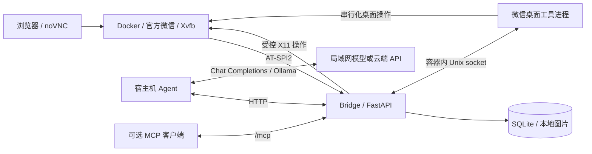

# Agent-Accessible-Wechat

在独立的 Docker 桌面中运行官方 Linux 微信，通过 AT-SPI2 读取一个已选定的群聊或私聊。Bridge 负责消息同步、SQLite 和受控发送。宿主机 Agent 负责人格、记忆与模型调用，支持通过 Ollama 或 Chat Completions 接入局域网模型，并按配置顺序回退到 DeepSeek 等服务。默认以人工确认方式发送。

单会话采集、陪伴回复与[微信桌面操作](#微信桌面工具与登录)共用一个官方客户端。Bridge 为 Agent 的 HTTP API 和可选的 MCP 端点提供同一份工具目录。项目自身负责消息归属、同步、记忆、回复决策和发送校验。

当前内置无障碍配置适用于微信 `4.1.13.29` 的 ARM64 和 AMD64 英文界面。其他语言和版本按实际无障碍树配置。登录后的采集、发送和原生操作验收范围见[验证记录](#验证记录)。



## 安装

### Apple Silicon / macOS

使用 Docker Desktop，或使用 Homebrew 安装 Colima、Docker CLI、Buildx 和 Compose。Agent 另需 uv。首次在 8GB Mac 上启动 Colima 可从 2 核、3GB 内存、20GB 磁盘起步。

```bash
brew install colima docker docker-compose docker-buildx uv
colima start --cpus 2 --memory 3 --disk 20
docker info --format '{{.Architecture}}'
docker compose version
docker buildx version
```

如果已安装 Homebrew 插件但 Docker CLI 找不到它们，在缺少相应链接时运行。

```bash
mkdir -p ~/.docker/cli-plugins
ln -s "$(brew --prefix)/lib/docker/cli-plugins/docker-compose" ~/.docker/cli-plugins/docker-compose
ln -s "$(brew --prefix)/lib/docker/cli-plugins/docker-buildx" ~/.docker/cli-plugins/docker-buildx
```

### Ubuntu 24.04 / x86_64

按官方步骤配置 Docker 软件源并安装 `docker-ce`、`docker-ce-cli`、`containerd.io`、`docker-buildx-plugin` 和 `docker-compose-plugin`。用可以访问本机 Docker Engine 的账户操作。 [Docker Engine 安装](https://docs.docker.com/engine/install/ubuntu/) · [uv 安装](https://docs.astral.sh/uv/getting-started/installation/)

```bash
sudo apt-get update
sudo apt-get install -y git curl openssl ca-certificates
curl -LsSf https://astral.sh/uv/install.sh | sh
docker info --format '{{.Architecture}}'
docker compose version
docker buildx version
```

安装 uv 后，如果当前 Shell 尚未识别命令，按安装提示更新 `PATH` 或重新打开终端。

Bridge 镜像根据 BuildKit 的 `TARGETARCH` 下载对应的官方微信安装包。Ubuntu x86_64 使用 `linux/amd64`，Apple Silicon 的原生 Docker 引擎使用 `linux/arm64`。微信桌面使用软件渲染，GPU 可留给宿主机上的模型服务。 [腾讯 Linux 微信](https://linux.weixin.qq.com/)

## 从新克隆启动

```bash
git clone https://github.com/MyouKin/Agent-Accessible-Wechat.git
cd Agent-Accessible-Wechat

if [ ! -e .env ]; then
  (
    umask 077
    printf 'BRIDGE_TOKEN=%s\nVNC_PASSWORD=%s\nBRIDGE_CONFIG_FILE=./config.local.yaml\n' \
      "$(openssl rand -hex 24)" "$(openssl rand -hex 4)" > .env
  )
fi
if [ ! -e config.local.yaml ]; then
  (umask 077; cp config.yaml config.local.yaml)
fi
```

已有 `.env` 时，检查 `BRIDGE_CONFIG_FILE=./config.local.yaml` 指向自己的配置。Docker 容器以 UID 1000 运行。在 Linux 宿主账户使用其他 UID 时，启动前为容器 UID 1000 授予本地配置文件的读取权限。可使用 `setfacl -m u:1000:r config.local.yaml`。缺少该命令时可用 `sudo apt-get install acl` 安装。

```bash
docker compose up -d --build --wait
docker compose ps
curl --fail --silent http://127.0.0.1:8765/health
```

打开 [本机 noVNC](http://127.0.0.1:6080/vnc.html?autoconnect=1&resize=scale)，输入 `.env` 中的 `VNC_PASSWORD`。用手机微信扫码并确认登录。先按[无障碍配置](#诊断-at-spi2-与选择器)填写 `accessibility_profile`，再[选择会话](#首次选择会话)。默认空配置可启动桌面和查看会话列表。选择并开始采集需要可用的无障碍配置。

`/health` 返回成功表示 HTTP 服务已启动。采集和自动操作需用 Bridge 凭据检查 `/status`。`source.ready` 和 `source.at_tail` 需为 `true`，以确认目标与可见尾部。通过 CLI 选定的目标见 `active_session`。恢复状态见 `session_restore`。首次可用快照建立基线，后续新消息才进入增量记录。

```bash
set -a
. ./.env
set +a
bridge_url="http://127.0.0.1:8765"
curl --fail --silent -H "Authorization: Bearer $BRIDGE_TOKEN" "$bridge_url/status"
```

API 和 noVNC 默认发布到宿主机环回。`BRIDGE_PORT` 和 `NOVNC_PORT` 可在 `.env` 中改变宿主机端口。VNC 密码要求 8 位 ASCII 字母或数字。Bridge API 使用独立 Bearer 令牌。

### 通过 SSH 打开 noVNC

Bridge 在远程主机上运行时，从浏览器所在主机转发 noVNC。用实际 SSH 账号和主机名替换 `user@bridge.lan`。若修改了 `NOVNC_PORT`，将命令末端的 `6080` 换成设置的端口。

```bash
ssh -N -o ExitOnForwardFailure=yes \
  -L 127.0.0.1:16080:127.0.0.1:6080 user@bridge.lan
```

连接后打开 [本地转发的 noVNC](http://127.0.0.1:16080/vnc.html?autoconnect=1&resize=scale)。

## 诊断 AT-SPI2 与选择器

在登录后的虚拟桌面中打开目标群或私聊，再从同一个容器和同一个 D-Bus 会话运行诊断。

```bash
docker compose exec bridge sh -c \
  '. "$XDG_RUNTIME_DIR/bridge-session.env"; python -m tools.inspect_atspi --events 10'
docker compose exec bridge sh -c \
  '. "$XDG_RUNTIME_DIR/bridge-session.env"; python -m tools.inspect_atspi --redact --events 8 --json /data/atspi-redacted.json'
mkdir -p diagnostics
docker compose cp bridge:/data/atspi-redacted.json diagnostics/atspi-redacted.json
docker compose exec bridge dpkg-query -W wechat
```

JSON 树包含角色、名称、描述、接口、边界、状态以及客户端提供的 Text、Image、Hypertext 和 Hyperlink 信息。`--all` 列出所有应用树，`--app` 可指定应用名。诊断文件可能包含聊天和成员资料，分享前使用 `--redact` 并检查内容。导出命令要求目标文件尚不存在。

在 `config.local.yaml` 配置无障碍映射。使用与安装包、架构和桌面语言对应的 `accessibility_profile`，英文客户端可选 `wechat-4.1.13.29-arm64-en` 或 `wechat-4.1.13.29-amd64-en`。原生引用、联系人卡片和照片查看器操作目前由 ARM64 配置提供。其他环境可先保持 `accessibility_profile: null`，完成诊断后填写自定义映射。配置保存后运行 `docker compose up -d --force-recreate --wait bridge`，再选择会话并检查 `/status`。

| 配置 | 说明 |
| --- | --- |
| `chat` | 可选的旧版群名配置。首次通过 CLI 选择会话后，Bridge 以持久化的会话为准。 |
| `source` | 第一阶段使用 `accessibility`。 |
| `poll_interval` | Bridge 轮询间隔，默认 0.5 秒。AT-SPI 事件也会触发刷新。 |
| `accessibility_profile` | 内置配置名称、自定义映射或 `null`。 |
| `lookup_sender_names` | ARM64 已验证配置可在输入框为空时读取新消息的联系人卡片。默认关闭。 |
| `native_image_viewer` | ARM64 已验证配置可尝试用微信照片查看器补充图片。默认关闭。 |
| `send_mode` / `send_key` | 默认 `manual` / `Return`。发送键也可为 `ctrl+Return`。 |
| `mcp_enabled` | 默认关闭。开启后使用 `MCP_TOKEN` 访问同一份工具目录。Agent 的 HTTP API 始终可用。 |
| `data_dir` | 容器内 Bridge SQLite 与媒体文件的目录，默认 `/data`。 |

自定义映射至少填写 `package_version`、`window`、`chat_header`、`message_list`、`message_row` 和 `input`。运行时选择会话还需要类型证据。群聊用 `group_count` 匹配真实可见的成员数控件，例如 `(5)`。私聊用 `private_header` 匹配有实际私聊证据、和标题节点不同的可见控件。类型证据缺失或冲突时，Bridge 会暂停采集与发送。选择器可使用由实际树得到的相对 `path`，或组合 `role`、`name`、`description`、`accessible_id`、`interfaces` 和 `attributes`。根据诊断补充 `body`、`sender`、`self_marker`、`other`、`image`、`sticker`、`link`、`timestamp` 与 `non_message`。尾部判断使用验证过的 `tail`、`scrollbar` 或实际列表尾行。支持 Value 接口的滚动条可设置 `recovery_step` 和 `recovery_pages`。

`message_type_selectors` 可为实际树中可核实的 `video`、`voice`、`file`、`chat_record`、`mini_program`、`location`、`contact_card` 和 `money` 分别填写行内选择器。唯一匹配时保存分类，多个匹配时标记 `unknown` 并保留提示。启用 `wechat_label_hints` 后，明确的微信括号占位符可提供类型证据。仅有普通标签或时长时保留为待确认提示。分类表示可访问界面中的证据。媒体仍以实际保存的文件为准。

可通过 `timestamp_format` 和 `timestamp_timezone` 解析明确提供完整日期和时区的时间。`sender_id_attribute` 和 `source_id_attribute` 可保存诊断确认真实稳定的节点属性。链接卡片可读取实际支持的超链接接口或可见 URL。

已在 YAML 的 `chat` 配置旧版群名时，可在该群可见的状态下运行只读配置检查。它只读取指定 YAML，检查结果以该文件里的群名为准。CLI 选定和重启恢复的运行时会话请用 `/status` 检查。

```bash
docker compose exec bridge sh -c \
  '. "$XDG_RUNTIME_DIR/bridge-session.env"; python -m tools.inspect_atspi --check-profile /app/config.yaml --json -'
```

检查返回码为 `0` 时，已验证可读目标群和可见尾部。`2` 表示尚未就绪，`1` 表示配置或会话错误。另看 `manual_send_preconditions`，它核对当前 X11 窗口、可读空输入框和引用预览是否为空。自定义配置要发送普通文本，须设置 `quote_preview`，让选择器能找到真实且隐藏的原生引用预览面板。可在微信中手动放入一条待发送引用再清除，对照两种树来定位该控件。缺少或无法核实该证据时，发送保持停用。原生引用、联系人卡片和照片查看器操作依赖已验证的内置配置。

在测试群依次发送短文本、同文两条和图片，通过 `/messages/new` 检查记录顺序、归属和媒体，再核对客户端发送键。

## 草稿、人工确认和自动发送

先保留 `send_mode: manual`。在目标会话尾部、发送输入框为空且 `source.ready` 为真时创建测试草稿。用 `/status` 中 `active_session.key` 作为下例的 `session_key`。旧版固定群名且 `active_session` 为 `null` 时用 `legacy`。

```bash
session_key="$(
  curl --fail --silent --show-error -H "Authorization: Bearer $BRIDGE_TOKEN" "$bridge_url/status" \
    | uv run --locked python -c 'import json,sys; session=json.load(sys.stdin)["active_session"]; print(session["key"] if session else "legacy")'
)"
request_id="$(openssl rand -hex 16)"
curl --fail --silent -X POST "$bridge_url/drafts" \
  -H "Authorization: Bearer $BRIDGE_TOKEN" \
  -H 'Content-Type: application/json' \
  --data "{\"text\":\"这是一条待确认的测试消息\",\"request_id\":\"$request_id\",\"session_key\":\"$session_key\"}"
```

草稿初始为 `pending`。通过 `GET /drafts/{id}?session_key=…` 检查文本和引用，确认目标是当前测试会话后，用实际草稿 ID 替换下例中的 `DRAFT_ID`。

```bash
curl --fail --silent -X POST "$bridge_url/drafts/DRAFT_ID/confirm?session_key=$session_key" \
  -H "Authorization: Bearer $BRIDGE_TOKEN"
```

Bridge 会重新核对微信窗口、目标会话、可见尾部和空输入框。发送后回读输入框及新消息，结果为 `sent`、`failed` 或 `uncertain`。遇到 `uncertain` 时先核对桌面、会话尾部和草稿状态。相同 `request_id` 的重复请求沿用原草稿。

自动发送需要在 `config.local.yaml` 设置 `send_mode: auto`，重新创建 Bridge，并在 Agent 的 `.env.agent` 设置 `AGENT_AUTO_SEND=true`。直接调用 HTTP 自动发送还须在每个请求中明确传入 `auto_send: true` 和稳定的 `request_id`。可先验证一次普通文本与原生引用的人工流程，再开启自动模式。Agent 在 Bridge 未就绪、目标改变或发送模式不匹配时暂停处理。

## HTTP 与 MCP

下表除 `GET /health` 外的业务 HTTP API 使用 `Authorization: Bearer $BRIDGE_TOKEN`。下面示例沿用草稿章节的 `bridge_url` 和 `session_key`。读消息、等待增量、取媒体、查草稿、确认草稿和读记忆时可传 `session_key` 查询参数。创建草稿或记忆时可在 JSON 中传入。会话发生变化时，携带旧键的请求返回 `409`。省略该参数时，请求使用 Bridge 当时的活跃会话。

```bash
curl --fail --silent -H "Authorization: Bearer $BRIDGE_TOKEN" \
  "$bridge_url/messages/new?after_id=0&limit=50&session_key=$session_key"
curl --fail --silent --get -H "Authorization: Bearer $BRIDGE_TOKEN" \
  --data-urlencode 'q=测试' --data-urlencode "session_key=$session_key" "$bridge_url/messages/search"
```

| HTTP 端点 | 用途 |
| --- | --- |
| `GET /health` / `GET /status` | 进程探测，以及活跃会话、恢复状态、当前选择的修订号和群昵称、窗口、源版本、尾部和同步状态。 |
| `GET /sessions` / `PUT /sessions/active` | 列出可见会话及 `active`、`complete`。传 `{"key":"…"}` 打开、校验并保存一个活跃会话。 |
| `PUT /sessions/active/mention` | 为当前群聊保存点名昵称，传入 `session_key`、`revision` 和 `mention_nickname`。修订号来自 `/status` 的 `session_selection`。传 `null` 清空。 |
| `GET /messages` / `GET /messages/new?after_id=ID` | 近期记录和按 ID 分页的增量。 |
| `GET /messages/wait?after_id=ID&timeout=15` | 等待已提交的新消息，超时返回 `{"messages":[]}`。最长 30 秒。 |
| `GET /messages/{message_id}` | 按当前会话的消息 ID 查看单条记录。 |
| `GET /sync/gaps?after_id=ID` | 按缺口 ID 查看当前会话已记录的同步缺口。 |
| `GET /messages/search?q=…` | 在当前会话的本地记录中搜索。近期和搜索端点可用 `for_model=true` 获取过滤视图。Agent 自身读取带归属信息的完整视图。 |
| `GET /media/{message_id}?index=0` | 读取已采集图片。已保存第二张时用 `index=1`。 |
| `POST /drafts` / `GET /drafts` / `GET /drafts/{id}` | 创建或检查草稿。除 `text` 外，可传 `chat`、`session_key`、`request_id`、`author_kind`、`quote_message_id`。 |
| `POST /drafts/{id}/confirm` | 人工确认并执行受控发送。 |
| `GET /memories` / `POST /memories` | 读取或保存当前会话的长期记忆。 |
| `GET /tools` / `POST /tools/{name}` | 获取共享工具目录，或传入该工具的 JSON 参数并执行。查询参数 `scope=conversation` 将目录和执行限定为当前会话的只读工具，可一并传入 `session_key`。 |

原生引用通过本地 `quote_message_id` 选择目标。Bridge 会核实可见文本行和当前会话，调用微信自己的引用菜单，再回读引用预览。目标不可见、重复候选或预览不符时，发送不会继续。模型只能选择进入其上下文且符合条件的真人文本作为原生引用目标。若当前无障碍配置只支持普通文本，Agent 会将模型的引用回复保存为普通文本草稿。

Agent 或其他受信本机程序使用 Bridge API 的 `BRIDGE_TOKEN` 访问 `GET /tools` 和 `POST /tools/{name}`。例如查询工具目录并调用微信状态。

```bash
curl --fail --silent -H "Authorization: Bearer $BRIDGE_TOKEN" "$bridge_url/tools"
curl --fail --silent -H "Authorization: Bearer $BRIDGE_TOKEN" \
  -H 'Content-Type: application/json' -d '{}' "$bridge_url/tools/wechat_status"
```

外部 MCP 客户端使用 Streamable HTTP 地址 `http://127.0.0.1:8765/mcp`。在本地配置设置 `mcp_enabled: true`，在 `.env` 添加由 `openssl rand -hex 24` 生成的独立 `MCP_TOKEN`，然后重新创建 Bridge。客户端通过 `Authorization: Bearer <MCP_TOKEN>` 连接。MCP 的 `tools/list` 和 HTTP 的 `GET /tools` 返回同一份目录。微信桌面进程就绪时，正常 Docker 部署提供 13 项项目工具和 65 项微信桌面工具。`MCP_TOKEN` 和 `BRIDGE_TOKEN` 属于本机操作员权限。启用桌面工具时，两者都能访问登录二维码、切换会话、跨会话发送和 X11 键鼠操作。桌面发送工具直接操作微信，也能在 Bridge 草稿模式下发送。只向获授权的本机操作者提供令牌。

本项目提供的工具如下。

| 用途 | 工具 |
| --- | --- |
| 状态与缺口 | `get_status`、`get_sync_gaps` |
| 消息与图片 | `get_recent_messages`、`get_new_messages`、`wait_for_messages`、`get_message`、`search_messages`、`get_media`、`get_configured_chat_messages` |
| 记忆 | `search_memories` |
| 草稿 | `draft_message`、`list_drafts`、`get_draft_status` |

`draft_message` 支持创建引用草稿。草稿查询返回状态和诊断信息。确认桥接草稿由带有 Bridge 控制令牌的 HTTP 接口或明确配置的 Agent 完成。 [MCP Python SDK](https://github.com/modelcontextprotocol/python-sdk)

## 微信桌面工具与登录

Bridge 的单会话同步、noVNC 和桌面工具共用同一容器、同一个官方微信客户端与 `wechat-home` 卷。微信工具进程默认启用，Bridge 通过容器内 Unix socket 调用它。图形操作共用 X11 操作锁，操作期间暂停 VNC 输入。管理工具切换界面后，采集会等待已配置的目标会话再次可读并回到消息尾部。通过会话 CLI 选择新目标时，Bridge 会主动打开并验证新目标。

按常规命令启动或更新 `docker compose up -d --build --wait bridge`。如需排查桌面驱动，可临时设置 `WECHAT_TOOLS_ENABLED=false`，由 Bridge 启动官方客户端。会话发现、切换和已保存选择的自动恢复依赖桌面工具进程。已有保存选择时，关闭驱动会让采集与发送暂停，重新启用后才能恢复。未保存会话选择时，可继续用 YAML 中的固定群名配置采集。需要自动登录观察器时设置 `WECHAT_TOOLS_AUTO_LOGIN=true`，再按客户端提示完成手机确认。

打开 [微信工具登录页](http://127.0.0.1:8765/wechat/login)，将 `BRIDGE_TOKEN` 填入密码框。页面显示登录状态和可用的登录画面，可刷新二维码与请求手机确认。HTTP 和 MCP 客户端分别使用各自的令牌，容器为私有工具进程生成临时凭据。之前为公开工具客户端配置的 `WECHAT_TOOLS_TOKEN` 可以从 `.env` 移除。更改宿主机 `BRIDGE_PORT` 时，同步调整登录页和客户端地址。

通过 `GET /wechat/health` 检查桌面工具进程。共享目录中包含 `wechat_ui_tree`、`wechat_screenshot` 和其他上游微信操作。账户资料按[停机卷备份](#跨主机复制数据)保存和迁移。

微信工具进程通过独立环境中的上游 Python 工具处理器操作桌面。固定上游 `wechat-mcp` 提交 `1a559f614c43e28abb2ec9936a5ad39579312916`，MIT 许可证位于镜像的 `/opt/operator/LICENSE`。上游桌面工具包含针对中文微信的界面选择器，其他语言和客户端版本需要实测。增量采集依然使用独立核实过的语言和 AT-SPI 配置。 [固定的上游版本](https://github.com/zongwei-tang/wechat-mcp/tree/1a559f614c43e28abb2ec9936a5ad39579312916)

### 附件

`wechat_send_image` 和 `wechat_send_file` 可使用 `/wechat-tools/inbox` 中的容器文件，或带文件名的 `data_base64`。工作目录由 `wechat-tools-data` 卷保存。将已经选定的本机文件写进收件目录。

```bash
docker compose exec -T bridge sh -c \
  'umask 077; set -C; cat > /wechat-tools/inbox/example.pdf' < ./example.pdf
```

然后传入 `path=/wechat-tools/inbox/example.pdf`。附件使用明确提供的本地文件或数据，URL 下载参数会被拒绝。

## 配置和启动宿主机 Agent

```bash
uv sync --locked --python 3.12
if [ ! -e .env.agent ]; then
  (umask 077; cp .env.agent.example .env.agent)
fi
```

在 `.env.agent` 按下节配置模型。群聊的点名昵称在[选择会话后](#首次选择会话)通过 `--set-mention` 填写。

项目自带的 `persona.md` 默认留空。可在里面填入自定义 system prompt，或将其他 UTF-8 文件的路径写入 `AGENT_PERSONA_PATH`。留空时，模型只接收 Agent 内置的会话和草稿规则。配置修改后重启 Agent。模型密钥保存在仅当前用户可读的环境文件中。 [uv 环境文件](https://docs.astral.sh/uv/configuration/files/#environment-variable-files)

### 模型优先级与自动回退

在 `.env.agent` 设置 `LLM_PROVIDER_ORDER` 后，Agent 每轮按逗号分隔的顺序尝试提供方。从配置名称的大写形式得到变量前缀，例如 `gemma` 对应 `LLM_GEMMA_`。下面先调用局域网的 Ollama Gemma，失败时调用 DeepSeek。将地址、模型名和密钥替换成实际值。 [Ollama Chat API](https://docs.ollama.com/api/chat) · [DeepSeek Chat Completions](https://api-docs.deepseek.com/api/create-chat-completion/)

```dotenv
LLM_PROVIDER_ORDER=gemma,deepseek
LLM_GEMMA_PROTOCOL=ollama
LLM_GEMMA_BASE_URL=http://inference.lan:11434
LLM_GEMMA_MODEL=gemma4
LLM_GEMMA_TIMEOUT_SECONDS=30
LLM_DEEPSEEK_BASE_URL=https://api.deepseek.com
LLM_DEEPSEEK_MODEL=deepseek-flash
LLM_DEEPSEEK_API_KEY=替换为实际密钥
LLM_DEEPSEEK_REASONING_EFFORT=none
```

| 每个提供方的变量后缀 | 用途 |
| --- | --- |
| `BASE_URL` / `MODEL` | 必填。Ollama 原生协议填写 `/api/chat` 之前的地址。Chat Completions 填写 `/chat/completions` 之前的地址，例如 llama.cpp 的 `http://127.0.0.1:8080/v1`。 |
| `PROTOCOL` / `API_KEY` | 协议默认 `openai`，也可设为 `ollama`。密钥存在时作为该提供方的 Bearer 令牌。 |
| `TIMEOUT_SECONDS` / `MAX_TOKENS` | 每轮在该提供方的总时限默认 45 秒。生成长度上限由提供方默认值决定，也可单独设置。 |
| `REASONING_EFFORT` / `TOOLS` / `QUOTE_TOOL` | 适用于 `openai` 协议。`TOOLS` 默认允许当前会话的只读工具，`QUOTE_TOOL` 默认关闭。模型不支持相应能力时，可关闭对应工具。 |
| `MULTIMODAL` | 默认关闭。给支持视觉且获准接收图片的提供方设为 `true`，同时开启 `AGENT_MULTIMODAL` 才会发送图片。 |

连接失败、超时、HTTP 错误或模型重试后仍未生成可用结果时，会尝试下一个提供方。模型明确拒绝、触发内容过滤或在无需回复时返回 `reply: null`，会结束本轮。日志记录提供方名称和错误类型。用于本地小飞鱼等兼容服务时，可将它加入 `LLM_PROVIDER_ORDER`，使用服务实际公布的模型名和 `/v1` 地址。

`LLM_PROVIDER_ORDER` 留空时，按原方式使用单一 Chat Completions 提供方，配置 `LLM_BASE_URL`、`LLM_MODEL` 和可选的 `LLM_API_KEY`。优先级列表中只要有一个非环回地址，处理真实会话前就需要设置 `AGENT_DATA_CONSENT=true`。

### 部署拓扑

Bridge 用 Docker Compose 运行，Agent 用宿主机上的 uv 运行。按 Agent 实际可访问的地址在 `.env.agent` 设置 `AGENT_BRIDGE_URL` 和模型地址。变更地址或模型优先级后重启 Agent。下文的主机名、SSH 账号和监听端口均可替换。

**Bridge、Agent 和推理同机。** 保留 `AGENT_BRIDGE_URL=http://127.0.0.1:8765`，若修改了 `BRIDGE_PORT`，使用对应端口。推理服务可监听环回，Agent 的模型地址例如 `http://127.0.0.1:8080/v1`。

**Bridge 和 Agent 同机，推理在另一台机器。** 局域网直连时，将模型地址设为推理服务的可达地址，例如 `http://inference.lan:8080/v1`，真实会话按上节设置 `AGENT_DATA_CONSENT`。若推理服务只监听自己的环回，可在推理主机上发起 SSH 反向转发。以下示例在 Agent 主机的 `127.0.0.1:18080` 接收请求，将对应的模型地址设为 `http://127.0.0.1:18080/v1`。

```bash
ssh -N -o ExitOnForwardFailure=yes \
  -R 127.0.0.1:18080:127.0.0.1:8080 user@agent.lan
```

**Bridge 和 Agent 分开部署。** 在 Agent 主机上发起 SSH 本地转发，把 `.env.agent` 中的 `AGENT_BRIDGE_URL` 设为 `http://127.0.0.1:18765`。在 Agent 主机的私有 `.env` 中设置与 Bridge 相同的 `BRIDGE_TOKEN`。如果 Bridge 主机使用自定义 `BRIDGE_PORT`，替换命令末端的 `8765`。模型仍可按前两种方式接入。

```bash
ssh -N -o ExitOnForwardFailure=yes \
  -L 127.0.0.1:18765:127.0.0.1:8765 user@bridge.lan
```

SSH 服务须允许对应方向的端口转发，运行时保持 SSH 连接。Bridge API 和 noVNC 默认在 Bridge 主机上绑定环回。远程扫码时，从浏览器所在主机[另行转发 noVNC](#通过-ssh-打开-novnc)，使用 `NOVNC_PORT` 对应的宿主机端口。 [OpenBSD ssh 手册](https://man.openbsd.org/ssh)

在 Agent 主机访问 `AGENT_BRIDGE_URL` 下的 `/health` 验证 Bridge 可达，再用带令牌的 `/status` 核对微信采集状态。[合成对话 `--demo`](#启动和模型上下文)用于测试 Agent 到模型的链路。若配置了多个提供方，可检查回退日志，或临时只配置一个提供方逐个验证。

### 首次选择会话

微信登录后，从 Agent 主机列出会话。列表和单独切换使用 `.env` 中的 Bridge 令牌和 `.env.agent` 中的 `AGENT_BRIDGE_URL`，可在配置模型前执行。

```bash
uv run --locked --env-file .env --env-file .env.agent python -m agent --list-sessions
```

表格包含名称、会话类型、微信原生 ID、本地选择键和活跃状态。当前驱动只枚举微信侧栏暴露的会话，最多检查 200 个节点，跳过折叠入口，因此会报告列表不完整。缺少类型证据时显示 `unknown`，原生 ID 无可核验证据时显示 `unavailable`。选择时使用表格里的 `Local key`。如未看到某个会话，可先在 noVNC 里将其显示在侧栏，再重新列出。

```bash
printf '输入表格中的 Local key '
IFS= read -r session_key
uv run --locked --env-file .env --env-file .env.agent python -m agent --set-session "$session_key"
```

Bridge 打开唯一同名的搜索结果，核对标题、类型和消息尾部，再把选择持久化到 `bridge-data` 卷中的 SQLite。对类型已确认的会话，若完整标题搜索同时返回一条匹配类型的结果和一条同名的未知类型结果，Bridge 会用较短的查询词重试，仍要求完整标题和类型唯一匹配。会话类型从 `unknown` 确认为群聊或私聊后，返回的本地选择键可能变化。后续 HTTP 请求使用 `/status` 中的 `active_session.key`。原生 ID 缺失时，本地会话键基于标题与类型。Bridge 会拒绝检测到的同名歧义或无法核验的会话，失败时保留上次保存的选择。在内置英文配置下，已选定会话的标题若在微信侧栏同时出现两条可识别记录，Bridge 会阻止受控发送。读取仍依据标题和类型。界面未暴露的同名会话或后来复用的名称，可能无法区分。

每次通过 `--set-session` 成功选择群聊，Bridge 都会清空点名昵称，重新选择同一个群也会清空。命令会提示填写微信在该群 `@` 文本中实际显示的本人昵称，填写时省略 `@`。

```bash
printf '输入本群实际显示的昵称 '
IFS= read -r group_nickname
uv run --locked --env-file .env --env-file .env.agent python -m agent --set-mention "$group_nickname"
```

Agent 在下一次轮询时使用新设置。留空时关闭文本 `@` 触发，其他触发按各自设置运行。Bridge 重启并恢复已选会话时会恢复本次设置。旧版 Bridge 和 YAML 中的旧版固定群配置可继续用 `.env.agent` 的 `AGENT_MENTIONS`。

首次选择时也可直接启动 Agent。准备好 `.env.agent` 后运行。

```bash
uv run --locked --env-file .env --env-file .env.agent python -m agent --set-session "$session_key" --run
```

重启 Bridge 后，它会等待登录并尝试重新打开已保存的会话。`session_restore` 为 `waiting` 时等待客户端就绪。为 `failed` 时，检查登录、会话标题和无障碍配置，再用 `--list-sessions` 和 `--set-session` 重新选择。恢复等待或失败时暂停采集和发送。只重启宿主机 Agent 时执行普通启动命令，它会使用 Bridge 已核实的活跃会话。

### 启动和模型上下文

用合成对话验证模型配置。`--demo` 访问配置的模型服务，需要模型可用并可能产生 API 用量。

```bash
uv run --locked --env-file .env --env-file .env.agent python -m agent --demo
```

Bridge 就绪后，启动活跃会话的 Agent。Agent 通过 Bridge HTTP API 读取消息、查询历史和提交草稿，关闭外部 MCP 也能运行。如果模型端点位于非环回地址，先取得参与者对共享会话数据的同意，再设置 `AGENT_DATA_CONSENT=true`。切换到另一会话前也需确认该会话的参与者同意。云端模型可能接收所选消息、引用、长期摘要及启用的图片内容。`LLM_MODEL`、可选 `LLM_MAX_TOKENS` 和 `LLM_REASONING_EFFORT` 以提供方协议为准。 [DeepSeek Chat Completions](https://api-docs.deepseek.com/api/create-chat-completion/)

```bash
uv run --locked --env-file .env --env-file .env.agent python -m agent
```

SQLite 按会话保存已同步的消息、草稿和长期记忆。群聊与同名私聊使用不同分区。每轮生成时，Agent 最多取 36 条近期消息，按长度整理，并加入触发消息、匹配的历史和记忆。模型可主动调用 `search_messages`、`get_message` 或 `search_memories`，由 Bridge 查询同一会话分区。即时原生读取补充当前上下文，增量同步器负责持久记录。

- `AGENT_AUTO_SEND` 默认关闭，可先检查 `/drafts` 中的建议。`AGENT_ALLOW_UNATTRIBUTED_MENTIONS=true` 可在人工模式处理归属未知的精确点名，这类触发只生成草稿。
- `AGENT_POLL_SECONDS` 默认 10 秒。确认来自真人的正文点名，以及对已验证 Agent 消息的引用，会逐条进入优先队列。普通参与依赖新的人类消息，判断间隔由 `AGENT_MIN_DECISION_INTERVAL` 控制，默认 60 秒。冷却期间收到的普通候选会等待到可判断时，届时仍有效的最新同优先级候选将与当前上下文一起交给模型，由模型决定回复或保持沉默。
- 私聊须先通过会话类型和无障碍尾部校验。只有明确归属为真人且确认来自对方的新消息才会逐条触发回复，无需点名。发送仍使用同一套草稿和确认配置。
- 模型首先使用结构化回复，支持工具的提供方可启用 `LLM_QUOTE_TOOL=true`。紧急触发可进行一次纯文本重试。模型仍无可用结果时，Agent 可对已验证的紧急触发生成简短确认，仍受同样的发送校验与幂等约束。
- 模型默认从共享目录获得当前会话的近期消息、消息查找、增量、历史搜索、记忆搜索和即时读取，每次决策最多查一次。Agent 读取已保存的消息、媒体和记忆以及调用查询工具时使用当前会话键。Bridge 校验目标和参数。私聊及无法用桌面工具核验的群聊，使用已核验的 AT-SPI 快照执行即时读取。可用 `AGENT_WECHAT_TOOLS=false` 关闭模型的额外查询。
- `AGENT_SELECTIVE_PARTICIPATION=false` 关闭普通选择性参与。引用中的旧正文作为上下文，只有新正文的点名才触发直接点名。人类群友、同账号真人和 Agent 自己生成的消息以不同归属提供给模型。
- `AGENT_MULTIMODAL=true` 允许视觉模型从 Bridge 接收当前上下文已保存的图片。使用优先级列表时，还需为接收图片的提供方设置 `MULTIMODAL=true`。群聊中的链接作为文本处理。
- 历史、记忆或图片读取失败时，Agent 可使用其余上下文，发送仍需重新验证目标和就绪状态。紧急触发正文或引用被近期上下文截断时，模型会收到单独的限长触发记录。结构化、工具和纯文本回复使用同一发言内容校验。
- `AGENT_STATE_PATH` 默认 `data/agent.db`。它保存活跃会话的游标、去重和待处理决策。同一会话重启时继续使用已保存的游标。切换会话后，Agent 从新会话当前最新的持久记录开始，之前的待处理决策会清除，Bridge 的历史仍保存在相应分区。自定义宿主端口时同时设置 `AGENT_BRIDGE_URL`。

### 本地 llama.cpp

在 Ubuntu RTX 5080 主机上先安装支持该 GPU 的 NVIDIA 驱动和 CUDA Toolkit，确认 `nvidia-smi` 与 `nvcc --version` 正常。下例使用支持 Gemma 4 的 llama.cpp 版本，加载对应的量化或微调 GGUF。对 16GB 显存，应先根据模型读入日志选择合适的量化和上下文大小。 [llama.cpp CUDA 构建](https://github.com/ggml-org/llama.cpp/blob/master/docs/build.md#cuda) · [llama.cpp 服务参数](https://github.com/ggml-org/llama.cpp/tree/master/tools/server)

```bash
git clone https://github.com/ggml-org/llama.cpp.git
cmake -S llama.cpp -B llama.cpp/build -DGGML_CUDA=ON
cmake --build llama.cpp/build --target llama-server -j 4
llama.cpp/build/bin/llama-server \
  --model /srv/models/companion.gguf --alias companion \
  --host 127.0.0.1 --port 8080 --n-gpu-layers 99 --ctx-size 4096
```

将 `.env.agent` 中对应设置替换为以下值。若此前设置了云模型专用的推理参数，删除对应的 `LLM_REASONING_EFFORT` 和 `LLM_MAX_TOKENS` 行。视觉模型需要兼容的投影文件，可在 llama-server 端配置 `--mmproj`。模型权重及其许可证从模型发布方获得。

```dotenv
LLM_BASE_URL=http://127.0.0.1:8080/v1
LLM_API_KEY=local
LLM_MODEL=companion
```

## 日常运行和迁移

前台 Agent 用 `Ctrl+C` 停止。Bridge 可独立继续采集。需要停止整个服务时，先停止 Agent，用 `GET /drafts` 确认当前 `sending` 的草稿已处理，再停止 Bridge。遇到 `uncertain` 时，通过 noVNC 核对会话尾部后再决定下一步。

```bash
docker compose ps
docker compose logs --tail=100 bridge
docker compose stop -t 30 bridge
docker compose start --wait bridge
```

常驻运行可将上述 `uv run` 命令交给 macOS 的用户级 launchd 或 Linux 的用户级 systemd。指定仓库绝对路径为工作目录，使用 `command -v uv` 查得的绝对可执行路径，并以普通用户读取两个环境文件。Linux 服务通过 `systemctl --user start`、`stop`、`restart` 管理，macOS 通过所创建 LaunchAgent 的 `bootstrap`、`bootout` 和 `kickstart` 管理。停机备份之前应确认进程已退出，避免常驻管理器再次拉起。 [systemd 用户服务](https://www.freedesktop.org/software/systemd/man/latest/systemctl.html)

`wechat-home` 卷保存微信账户与客户端文件，`bridge-data` 卷保存 Bridge SQLite 和媒体。停机和普通 `docker compose down` 保留数据卷。带 `-v` 的 `down` 会删除卷，备份和迁移期间应避免使用。按实际用途保管备份，含登录会话、聊天内容、模型环境文件及私有人格的文件应使用私有传输和存储。

### 同一 Docker 引擎复用旧项目的卷

新克隆默认使用 Compose 项目名 `agent-accessible-wechat`。此前用 `wechat-companion-bridge` 项目名启动且要继续使用原卷时，先停止旧 Agent 和旧 Bridge，在新目录准备私有配置与凭据，再显式沿用旧项目名。

```bash
docker volume ls --filter label=com.docker.compose.project=wechat-companion-bridge
docker compose -p wechat-companion-bridge up -d --build
```

沿用旧项目名期间，后续对该服务的 `ps`、`logs`、`exec` 和 `stop` 命令也使用相同 `-p` 参数。新旧项目切换到同一组卷时，只保留一个 Bridge 和一个匹配的 Agent。

### 跨主机复制数据

在源机停止 Agent 与 Bridge 后，按实际 Compose 项目名打包完整卷。下例用新项目名，源机如使用旧项目名就调整 `backup_project`。

```bash
backup_project=agent-accessible-wechat
umask 077
backup_dir="$(mktemp -d "$HOME/agent-accessible-wechat-backup.XXXXXX")"
for logical_name in wechat-home bridge-data; do
  volume_name="$backup_project"_"$logical_name"
  docker volume inspect "$volume_name" >/dev/null || exit 1
  docker run --rm -v "$volume_name:/volume:ro" debian:12-slim \
    tar -C /volume -cpf - . > "$backup_dir/$logical_name.tar"
done
printf '%s\n' "$backup_dir"
```

将两个归档传到目标机的私有目录。准备环境文件和可读的 Bridge 配置，并为目标项目创建容器及新卷。确认卷是本次恢复专用，将归档解包后再启动。

```bash
target_project=agent-accessible-wechat
backup_dir="$HOME/agent-accessible-wechat-backup" # 改成归档所在目录
docker compose -p "$target_project" create --build bridge
for logical_name in wechat-home bridge-data; do
  volume_name="$target_project"_"$logical_name"
  docker run --rm -i -v "$volume_name:/volume" debian:12-slim \
    tar --numeric-owner -C /volume -xpf - < "$backup_dir/$logical_name.tar"
done
docker compose -p "$target_project" up -d bridge
```

SQLite 使用 WAL，卷备份应包含 SQLite、媒体和其他旁文件。源机的 `agent.db` 只在恢复同一 Bridge 数据谱系时一并迁移。重建 Bridge 数据库时使用新的 Agent 状态文件。Linux 上重新运行 uv 创建虚拟环境，重新配置 `AGENT_PERSONA_PATH`、`AGENT_STATE_PATH` 与本机凭据。微信可能要求在目标机重新扫码或手机确认。 [Docker 卷备份和恢复](https://docs.docker.com/engine/storage/volumes/#back-up-restore-or-migrate-data-volumes)

## 验证记录

以下命令用于重跑本机自动化与构建检查。实机记录区分未登录冒烟测试和登录后操作。

```bash
uv sync --locked --python 3.12 --extra mcp
uv run --locked --extra mcp pytest -q
docker buildx build --check -f docker/Dockerfile .
```

| 场景 | 验证范围 |
| --- | --- |
| ARM64 / 发布构建 | 原生无缓存构建，下载官方 `4.1.13.29` ARM64 安装包。验证 Python 3.11.2、GI、HTTP 健康和鉴权、noVNC 和 RFB 鉴权，以及 AT-SPI 应用注册。默认空群配置的诊断状态为 `unconfigured`。 |
| ARM64 / Apple Silicon Colima 历史实测 | 已在英文微信 `4.1.13.29` 验证构建、noVNC 鉴权、手机登录、登录后 AT-SPI2 树、真实群消息同步、中文和 Emoji 发送、原生引用、有限历史回溯，以及容器重建后数据卷保留。 |
| ARM64 微信工具集成 | 在离线容器中验证 Bridge 的 AT-SPI 与 65 个上游工具共用同一微信 PID。HTTP 和 MCP 列出相同的 78 项工具，已调用状态、无障碍树和截图。真实登录后的桌面操作待验收。 |
| AMD64 / Rosetta | 曾用官方 `4.1.13.29` 构建镜像，验证未登录启动、AT-SPI 应用注册、noVNC 页面、未鉴权 API 返回 `401` 及鉴权状态请求。 |
| Ubuntu x86_64 原生 Docker | 验证了官方 `4.1.13.29` 英文客户端、容器启动、Bridge 健康检查、noVNC、扫码登录和登录后群聊无障碍树。原生发送单独验收。 [GitHub Actions 检查](https://github.com/MyouKin/Agent-Accessible-Wechat/actions/workflows/checks.yml) |
| 运行时会话选择与私聊 | 合成桌面和 Bridge/Agent 测试覆盖列表、同名切换校验、选择恢复、隔离查询与私聊草稿。真实账号登录后的会话发现、恢复和私聊收发待实机验收。 |
| 模型链路 | 本地合成测试覆盖模型协议、上下文、媒体、草稿、路由和去重。ARM64 测试群曾用 DeepSeek 选择已见文本并确认微信原生引用。RTX 5080 上的小飞鱼 12B v4 已通过本机和服务器经 SSH 转发的合成对话验证。 |

已核实的 ARM64 与 AMD64 安装包版本为 `4.1.13.29`。可在 `.env` 配置 `WECHAT_ARM64_SHA256` 和 `WECHAT_AMD64_SHA256` 固定已核验的散列。上游更新后，重新检查包版本和实际无障碍树。 [腾讯 Linux 微信下载](https://linux.weixin.qq.com/)

### 已知边界

- 一次采集一个可核实的会话。窗口切换、登录失效、滚动离开尾部和无障碍节点失效都会影响采集。Bridge 尝试有限历史回溯并记录无法恢复的缺口。
- 同文多条按序列处理。可见区域被同样的文本或占位符填满时，界面信息可能无法区分个别发生次数。原始发送时间取不到时仅保留 `observed_at`。
- 截图可用性依赖控件或气泡边界。照片查看器、昵称与原生引用解析依赖已验证的客户端和配置，链接卡片的真实 URL 依赖微信公开的可访问接口。
- 作者归属以 `author_kind`、`author_source` 和微信方向 `is_self` 表示。无法核实的归属保留为未知。真人的新正文与引用内容分别保留。
- 部分内嵌网页功能可能受容器沙箱限制。桌面自动操作和会话迁移可能触发微信设备验证或账号风控，请使用有权操作的账户，并在把会话内容发给云端模型前取得参与者同意。
- 读取接口是 `bridge.models.MessageSource`。将来可添加获合法授权的只读 `DatabaseSource`，复用统一消息结构并继续使用独立 X11 发送。当前发布包含可访问接口方案。

## 参考

- [wechat-selkies](https://github.com/nickrunning/wechat-selkies)
- [wechat_linux](https://github.com/RisingWater/wechat_linux)
- [WechatOnCloud](https://github.com/Gloridust/WechatOnCloud)
- [wechat-mcp](https://github.com/zongwei-tang/wechat-mcp)
- [pywechat 的 Linux 无障碍记录](https://github.com/Hello-Mr-Crab/pywechat/issues/303)
